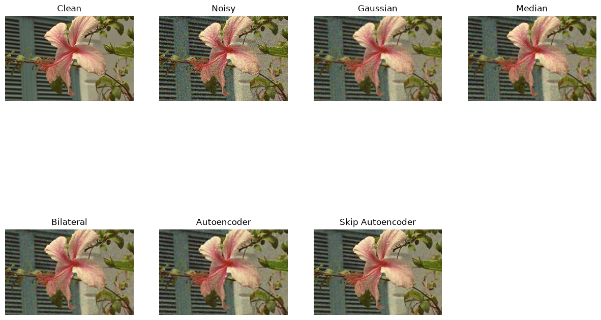

# Intelligent denoising based on autoencoders

Final project of the robot_dreams **Computer Vision** course — topic 2, *Denoising*.

### Motivation
Any photo can have noise, which can be low light, too high ISO etc. It is not only making images visually bad, but also can impact other phases in CV pipelines, like detection, classification etc.

Purpose of the project is to build intelectuall denoiser and compare it with Gaussian filtering

### Introduction
Existing methods:
- Gaussian blur, simple quick but blurs edges
- median filter, bilateral filter (keep edges).
- Non-Local Means, BM3D
- Neural net, e.g. denoising autoencoder DnCNN, UNet. Net trains on clear and noised images

Model based on the convolutional autoencoder from official Keras example ([Convolutional autoencoder for image denoising](https://keras.io/examples/vision/autoencoder), MNIST, Gaussian noise `0.4`). We apply this approach to CIFAR10 color images, add salt n pepper noise and compare the results with classical filters in numbers.

### Project summary
* **Data:** CIFAR-10 (training and test), Kodak photos (demo on real photos).
* **Noise:** Gaussian (`sigma = 0.1`) and salt & pepper (`probability = 0.1`).
* **Baselines:** OpenCV Gaussian, Median and Bilateral filters with parameters chosen on a validation set.
* **Metrics:** PSNR (dB) and SSIM.
* **Models:** the convolutional autoencoder from the Keras example and an improved version with skip connections (U-Net idea).

## Installation

You need Python 3.11–3.13.

```bash
git clone <repo-url> cv-project
cd cv-project
python3 -m venv .venv
source .venv/bin/activate
pip install -r requirements.txt
```

Install only `opencv-contrib-python` 4.x (from `requirements.txt`). OpenCV 5.0 from conda-forge crashes `import tensorflow`.
If you use conda, remove it first: `conda remove opencv py-opencv libopencv`.

CIFAR-10 (~170 MB) downloads automatically on the first run. The Kodak photos are already in `data/`.

## Usage

Start Jupyter from the repository root (the notebook loads photos from `data/`):

```bash
jupyter lab
```

Open `Denoising.ipynb` and select *Run → Run All Cells*.
The full run takes ~1 hour on CPU (most of the time is training). For a quick check, set `epochs = 1` in Step 4.

To run the notebook without the UI:

```bash
jupyter nbconvert --to notebook --execute --inplace --ExecutePreprocessor.timeout=1800 Denoising.ipynb
```

The notebook saves the model weights to `models/` and the images to `results/`.

## Repository structure

```
├── Denoising.ipynb     # main notebook: data, noise, baselines, models, evaluation
├── data/               # Kodak test photos (kodim*.png)
├── results/            # images for the report
├── models/             # trained weights (created at run time, not in git)
├── requirements.txt
└── README.md
```

## Results

10 000 CIFAR-10 test images, *PSNR dB / SSIM*, higher is better.

| Method | Gaussian, `sigma = 0.1` | Salt & Pepper, `p = 0.1` |
|--------|------------------------|--------------------------|
| Noisy | 20.33 / 0.654 | 15.08 / 0.465 |
| Gaussian | 24.71 / 0.812 | 21.71 / 0.689 |
| Median | 23.74 / 0.758 | 25.98 / 0.865 |
| Bilateral | 26.00 / 0.848 | 17.65 / 0.499 |
| Autoencoder (Keras example) | 24.88 / 0.810 | 24.05 / 0.777 |
| **Autoencoder with skip connections** | **28.07 / 0.906** | **34.25 / 0.980** |

Kodak photos 768×512 (the models were trained only on 32×32):

| Noise | Best filter | Autoencoder | Skip Autoencoder |
|-------|-------------|-------------|------------------|
| Gaussian | Bilateral 27.80 / 0.680 | 27.35 / 0.744 | **30.21 / 0.822** |
| Salt & Pepper | Median 29.92 / 0.875 | 26.68 / 0.723 | **34.82 / 0.946** |



**Conclusions:**

* The base autoencoder from the Keras example is better than the Gaussian filter, but worse than the best filters (bilateral, median): the 8×8 bottleneck loses small details.
* The autoencoder with skip connections is better than **all** filters on both noise types: +2.1 dB on Gaussian noise and +8.3 dB on salt & pepper.
* The models trained on 32×32 also work on full-resolution photos.
* Weakness: a separate model for each noise type; the quality drops if the noise level is different.

More details are at the end of [`Denoising.ipynb`](Denoising.ipynb).
